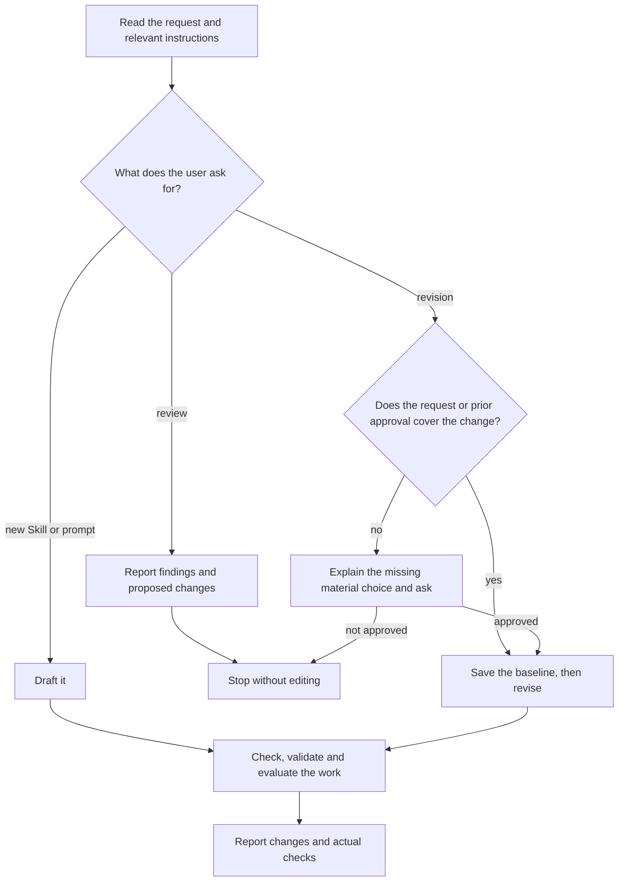

# Skillwriter

Write, simplify or review instructions while preserving their intended behavior.
Before this work, read [agent instruction design](references/instruction-design.md)
for the shared frontier-model writing and diagram rules.

## Choose the mode

A concrete revision request authorizes its changes; a review remains read-only.
Ask only when a material change to outcome, scope or boundaries is not covered by
the request or prior approval. Before revising, preserve the exact affected
pre-edit state through a Git revision containing it or a temporary workspace
copy. Keep this baseline through the final comparison.

## Preserve the intention

Keep the intended outcome, scope, activation boundaries, facts, permissions,
required behavior and acceptance criteria unless the user explicitly asks to
change them. Shorter text alone is not an improvement.

Read the relevant instruction set: `SKILL.md`, references, included fragments and
imported prompts needed to understand the change and its effects. Reuse fully
retained unchanged text. Edit sources and regenerate derived copies through
their build path. Check affected consumers before changing shared text.

## Work with Skill Creator

For Skill authoring, load the host's `skill-creator`: OpenAI's in Codex,
Anthropic's in Claude Code. It owns structure, metadata, packaging and format
validation; Skillwriter owns wording. Do not edit its files. If none is
available, draft the wording and report packaging as unverified. Standalone
prompts need no Skill package.

## Check the work

Review changed instructions and affected consumers once in the existing source
review; for new writing review the authored instruction set. Check that:

- an agent can complete the task, and required behavior and boundaries are clear;
- authorization, activation and handoffs agree with their owning contracts;
- rules remain consistent, without unnecessary duplication or constraints;
- every diagram path agrees with the text. Parse Mermaid with a renderer or
  parser when available; otherwise report the syntax as unverified;
- for a revision, compared with the baseline, the approved changes are carried
  through without unintended changes to meaning, behavior or boundaries.

Correct deviations within the authorized scope and recheck affected findings.
Report unresolved mismatches; add no separate authoring review or certificate.
Source review does not prove model performance.

## Validate and evaluate

Validate Skill structure through Skill Creator; this proves format, not quality.
If a validator rejects a field the Agent Skills specification allows, such as
`compatibility`, keep the field and report the limit.

Choose checks by what the change can affect, using the required target models
and settings. Add model-specific detail only where their results require it.

| Change | Check |
| --- | --- |
| Wording or layout only | Clarity, consistency and preserved meaning against the baseline |
| Required behavior or output | Exercise the affected outcome and preserved boundaries |
| Activation or scope | Explicit and implicit activation, plus adjacent requests that must not activate |

Run a comparative evaluation only when the user requests one or the work claims
improved effectiveness; follow
[sources and evaluation](references/sources-and-evaluation.md). Read it also
when citing vendor advice or research.

Report activation, procedural compliance, boundaries and task success separately
for what was tested, and name what remains unverified. Shorter text, higher
effort or self-reported success do not prove improvement. A claim that a model
follows the instructions requires a run with that model.
