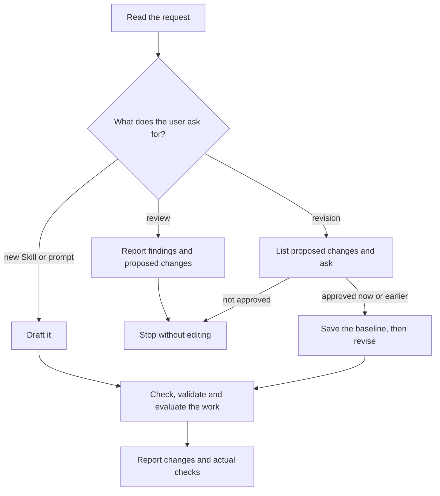

# Skillwriter

Write for current frontier models of OpenAI and Anthropic unless the request or
project names other target models. They follow instructions closely and take
over-specific, conflicting or emphatic guidance literally. Give them what they
lack and constrain only what must not vary. Mark provider-specific advice.

## Choose the mode

For a review or revision, first read the instructions, including linked and
imported text.

- **New writing:** Draft without asking for confirmation.
- **Review:** A review does not authorize edits.
- **Revision:** Identify the intended outcome, list the proposed changes with
  their purpose and ask. If the user already approved these concrete changes,
  do not ask again. Before editing, save the exact pre-edit state of every
  affected file as the baseline: a Git revision that contains it, otherwise a
  copy in the workspace's temporary directory. Keep it until the final
  comparison.

## Preserve the intention

Keep the intended outcome, scope, activation boundaries, facts, permissions,
required behavior and acceptance criteria unless the user explicitly asks to
change them. Shorter text alone is not an improvement.

The instruction set is `SKILL.md`, its references, included fragments and
imported prompts. Edit source files and regenerate derived copies through their
build path. Before changing shared text, check every file that uses it.

## Work with Skill Creator

For Skill authoring, load the host's `skill-creator`: OpenAI's in Codex,
Anthropic's in Claude Code. It owns structure, metadata, packaging and format
validation; Skillwriter owns wording. Do not edit its files. If none is
available, draft the wording and report packaging as unverified. Standalone
prompts need no Skill package.

## Shared instruction design

Before reviewing, drafting or revising instructions, read
[agent instruction design](references/instruction-design.md). It owns the
shared frontier-model writing and diagram rules, including agent-facing prompts.

## Shape the Skill

- **Description:** State what the Skill does and when to use it, key trigger
  first, in one or two third-person sentences. It decides activation among many
  Skills: vague text over-triggers, long text gets truncated.
- **Router:** Keep the core workflow in `SKILL.md`. Move conditional detail to
  references one level deep and state when to read each.

## Check the work

Read the final instruction set: for new writing all of it, for a revision every
changed file and every file that depends on changed text. Check that:

- an agent can complete the task, and required behavior and boundaries are clear;
- no rule conflicts with another, restates default behavior or over-constrains;
- every diagram path agrees with the text. Parse Mermaid with a renderer or
  parser when available; otherwise report the syntax as unverified;
- for a revision, compared with the baseline, the approved changes are carried
  through without unintended changes to meaning, behavior or boundaries.

Correct deviations within the authorized scope and report any unresolved
mismatch. This self-check is not proof of model performance.

## Validate and evaluate

Validate Skill structure through Skill Creator; this proves format, not quality.
If a validator rejects a field the Agent Skills specification allows, such as
`compatibility`, keep the field and report the limit.

Choose checks by what the change can affect:

If the request or project requires additional target models, test those models
and add only the detail their results show is needed.

| Change | Check |
| --- | --- |
| Wording or layout only | Clarity, consistency and preserved meaning against the baseline |
| Required behavior or output | The affected outcome and preserved boundaries |
| Activation or scope | Explicit and implicit activation, plus adjacent requests that must not activate |

Run a comparative evaluation only when the user requests one or the work claims
improved effectiveness; follow
[sources and evaluation](references/sources-and-evaluation.md). Read it also
when citing vendor advice or research.

Report activation, procedural compliance, boundaries and task success separately
for what was tested, and name what remains unverified. Shorter text, higher
effort or self-reported success do not prove improvement. A claim that a model
follows the instructions requires a run with that model.
