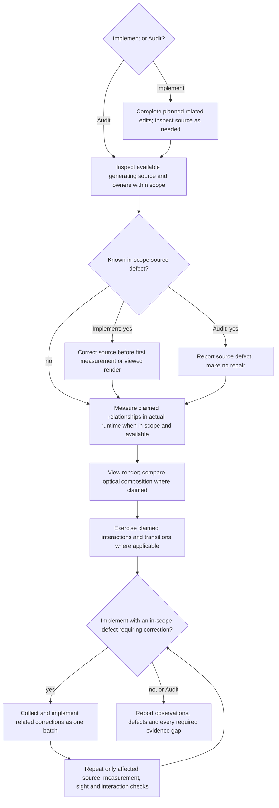

# Rendered UI Validation

Apply the common claim, scope and evidence gates below. Read the complete
additional reference when the requested claim needs it:

| Claim or mechanism | Reference |
| --- | --- |
| Geometry, layout, alignment, responsive composition or optical comparison | [Geometry and sight](ui-geometry-validation.md) |
| Navigation, controls, dialogs, forms, authentication or asynchronous transitions | [Interaction and transitions](ui-interactions.md) |
| Consistency across a named page or region | [Audit coverage](ui-consistency-audit.md) |

Select relevant conditions by scope and risk; preserve every applicable gate.
Source or build checks never replace required rendered or interactive proof.

## Establish the claim

State what the change is supposed to improve and which observable result would
show it. Separate claims about:

- source or build correctness;
- framework and token alignment;
- rendered layout and hierarchy;
- interaction and state behavior;
- responsive or adaptive behavior; and
- accessibility conformance.

Evidence for one category does not prove another. A passing build cannot prove
that text is visible; one screenshot cannot prove keyboard operation; an
automated audit cannot prove that a task is understandable.

For a supplied product decision, use its validation target and preserve
its evidence status. Report any implementation constraint to its owner; do not
silently substitute a different layout or visual system.

## Derive the test surface

Before implementation or audit measurement, select the layout claims, normative
limits and concrete risks that can change the result. Use the project's
supported environments and only relevant combinations of:

- viewport, window mode, orientation, or safe-area constraints;
- mouse, keyboard, touch, switch, or platform navigation;
- default, focus, hover, pressed, selected, disabled, loading, success, error,
  empty, or permission states;
- supported themes and contrast modes;
- realistic short, long, dynamic, and localized content; and
- text scaling, browser zoom, reduced motion, and other supported user settings.

Do not impose a universal breakpoint list or test every possible combination.
Include a condition when it could change the decision or expose a failure in the
requested flow. A broad viewport can establish the requested composition, but
it is not a separate accessibility threshold.

For affected web UI with an AA target, include these applicable checks:

- Operate the affected primary flow using only the keyboard and inspect visible
  focus at each step. Retain [WCAG 2.1.1's exceptions](https://www.w3.org/WAI/WCAG22/Understanding/keyboard.html)
  and verify [WCAG 2.4.7](https://www.w3.org/WAI/WCAG22/Understanding/focus-visible.html).
- For each affected view, check reflow at an equivalent width of 320 CSS px for
  vertically scrolling content, such as 1280px at 400% zoom. Preserve information
  and functionality; the exception for content requiring two-dimensional layout does not exempt
  the whole page. See [WCAG 1.4.10](https://www.w3.org/WAI/WCAG22/Understanding/reflow.html).
- Calculate contrast for distinct new, changed or audited text and background pairs
  in their rendered states: 4.5:1, or 3:1 for large text (at least 18pt/24 CSS px,
  or 14pt/18⅔ CSS px bold), retaining
  [WCAG 1.4.3's exceptions](https://www.w3.org/WAI/WCAG22/Understanding/contrast-minimum.html).
- Required non-text control and state cues and authored focus indicators need 3:1
  against adjacent colors. Apply [WCAG 1.4.11's scope and exceptions](https://www.w3.org/WAI/WCAG22/Understanding/non-text-contrast.html),
  including inactive controls and unmodified browser-owned appearance; do not
  apply the threshold to every decorative surface.

When elements are added, removed or changed, include the affected group's
composition and responsive transitions, not only the edited element. Check
relevant widths and states that could expose broken grouping, wrapping,
overflow or unavailable actions.

When a flow supports multiple input methods and one method can leave focus,
selection, pointer capture, composition, or shared state that affects another,
exercise at least one relevant handoff in the same task, such as pointer to
keyboard. Separate clean-start passes for each method do not prove that the
transition works. Do not create a cross-input matrix when the methods are
behaviorally independent.

For a changed shared component, inspect each immediately affected use with a
different role, variant, state or layout relationship. Render representative
distinct uses; identical copies need no separate proof.

When polished presentation is an explicit outcome, rendered evidence must show
a representative populated state rather than only an empty, loading, or error
state. Use realistic information density, content lengths, hierarchy, and at
least one relevant interaction state. Capture each target viewport named by the
task as its own observation so a desktop result does not stand in for mobile or
vice versa.

Keep recovery-state evidence separate: a convincing error state
does not prove the primary populated surface, and the reverse is equally true.

Compare the rendered emphasis with the primary task: decision-critical values,
states and actions must remain readily readable and findable, without
decoration obscuring or competing with them. Judge the task, not a fixed size
hierarchy or a prescribed visual style.

## Styling exceptions

Before custom styling, including inline styles and styling props, identify the
unmet requirement and the exact API or component responsible. Explain why its
supported behavior is insufficient and identify the smallest affected scope. An official token alone does not justify the exception. Prefer
supported composition and variants. Keep the rationale in the task result or
an existing project record; no separate document is required. Inspect the final
diff for unnecessary custom styling and obsolete compensation.

## Source first, then measurement, then sight

At Source, inspect markup/components, supported props and variants, styles and
owning framework/design system. Check duplicate spacing owners, arbitrary
sizes/offsets, token bypass, primitive rebuilds and obsolete overrides. Run
relevant existing syntax, lint, component or build checks. Build success does
not establish correct component ownership, rendering or geometry.
For Measurement and Sight use [geometry and comparison](ui-geometry-validation.md):
independent targets, actual distances and viewed component contents as well as
outer layout. Container overflow alone proves no internal alignment; numeric
equality proves no optical alignment. Images prove no interaction.

These gates follow the requested claim and available evidence, not an expanded
scope. Source-only and screenshot-only requests retain their limits. Missing
source/tools limit the conclusion; continue the permitted available observations
and report every required gap, never a pass. Usable tools cannot be skipped for
convenience. Final measurements and viewed images
must represent the same revision, content and state; unchanged evidence remains
usable. Refresh invalidated evidence before claiming completion.

## Use automation as supporting evidence

Run focused component, integration, visual-regression, and accessibility checks
already owned by the project when they cover the change. Add or change automated
coverage only when it protects a behavior that can regress and the repository
has a canonical test seam. Do not create screenshot churn or assertion-free
tests to simulate proof.

Treat scanner output as a lead and a bounded check. Confirm relevant findings in
the rendered interface and interaction path.

## Handle reviews and missing renderers

For an audit without an implementation request, inspect the available rendered
surface and return prioritized findings with the observed evidence, affected
task, owner, and consequence. Do not silently redesign or edit.

If no browser, simulator, device, terminal harness, or runnable application is
available, inspect source only far enough to identify likely risks. Report
rendered behavior, responsiveness, and visual quality as unverified. Do not turn
absence of evidence into a pass.

## Report the result

Report:

- the surfaces and conditions actually rendered;
- the task and states exercised;
- relevant automated checks and their result;
- framework or design-system alignment observed; and
- residual unverified conditions or owner conflicts.

When supplied evidence explicitly names unobserved conditions that bound the
requested claim, retain those conditions individually or in an equally precise
grouping. A broad caveat does not preserve a narrower evidence gap.

Avoid generic claims such as "responsive," "accessible," or "looks good" when
the evidence covers only a narrower condition.

## Interface text evidence

For new or changed interface text and consistency audits, compare concept names
across affected views, states and in-scope languages using Quality's wording
rules. Check that labels describe actual behavior and that accessible names
contain visible control text. Inspect wording in source and in rendered context;
source alone does not prove its presentation or the action's runtime behavior.
