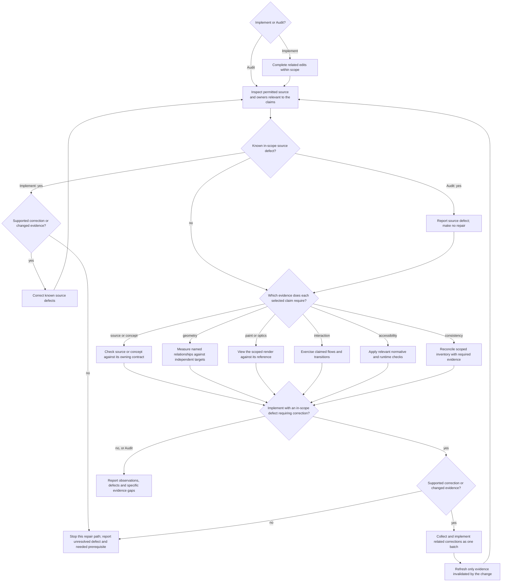

# Rendered UI Validation

## Establish the claim

State what the change is supposed to improve and which observable result would
show it. Use the matching evidence and read each triggered reference completely:

| Claim | Decisive evidence | Does not prove | Reference |
| --- | --- | --- | --- |
| Source or build correctness | Source inspection; relevant existing lint, build or component checks | Rendering, geometry or interaction | — |
| Unimplemented concept | Supplied brief, product decisions and task-specific design reasoning | Implemented or rendered behavior | [Quality](ui-quality.md) for open concerns |
| Framework or token alignment | Owning component, variant and token; resolved style at the affected element | Painted or layout effect | [Framework](framework-alignment.md) when ownership is open |
| Layout, spacing, alignment or adaptation | Runtime geometry of the named relationship at the actual elements, against an independent target | Glyph position, baseline or optical balance | [Geometry and sight](ui-geometry-validation.md) |
| Painted appearance or optical alignment | Viewed render compared with its reference | Exact distances or interaction | Geometry and sight |
| A setting's visible effect or absence | Relevant layout or painted effect at its actual consumer | Source agreement, a declaration or a computed value alone | Geometry and sight |
| Interaction or state behavior | Exercised flow and transitions in an interactive runtime | Visual quality | [Interactions](ui-interactions.md) |
| Accessibility conformance | Applicable checks below and confirmed scanner findings | Task understanding | — |
| Consistency across a page or region | Complete scoped coverage | A partial sample | [Audit coverage](ui-consistency-audit.md) |

Evidence for one claim does not prove another. Use a supplied decision's target
and retain its evidence status; settled design still requires correct mechanics.

## Derive the test surface

Before implementation or audit measurement, select the layout claims, normative
limits and concrete risks that can change the result. Use the project's
supported environments and only relevant combinations of:

- viewport, window mode, orientation, or safe-area constraints;
- mouse, keyboard, touch, switch, or platform navigation;
- default, focus, hover, pressed, selected, disabled, loading, success, error,
  empty, or permission states;
- supported themes and contrast modes;
- realistic short, long, dynamic, and localized content; and
- text scaling, browser zoom, reduced motion, and other supported user settings.

Include a condition when it could change the decision or expose a failure in the
requested flow; use owner-defined transitions and the applicable normative limits.
A broad viewport may establish composition without being an accessibility threshold.

For affected web UI with an AA target, include these applicable checks:

- Operate the affected primary flow using only the keyboard and inspect visible
  focus at each step. Retain [WCAG 2.1.1's exceptions](https://www.w3.org/WAI/WCAG22/Understanding/keyboard.html)
  and verify [WCAG 2.4.7](https://www.w3.org/WAI/WCAG22/Understanding/focus-visible.html).
- For each affected view, check reflow at an equivalent width of 320 CSS px for
  vertically scrolling content, such as 1280px at 400% zoom. Preserve information
  and functionality; the exception for content requiring two-dimensional layout does not exempt
  the whole page. See [WCAG 1.4.10](https://www.w3.org/WAI/WCAG22/Understanding/reflow.html).
- Calculate contrast for distinct new, changed or audited text and background pairs
  in their rendered states: 4.5:1, or 3:1 for large text (at least 18pt/24 CSS px,
  or 14pt/18⅔ CSS px bold), retaining
  [WCAG 1.4.3's exceptions](https://www.w3.org/WAI/WCAG22/Understanding/contrast-minimum.html).
- Required non-text control and state cues and authored focus indicators need 3:1
  against adjacent colors. Apply [WCAG 1.4.11's scope and exceptions](https://www.w3.org/WAI/WCAG22/Understanding/non-text-contrast.html),
  including inactive controls and unmodified browser-owned appearance; do not
  apply the threshold to every decorative surface.

When elements are added, removed or changed, include the affected group's
composition and responsive transitions, not only the edited element. Check
relevant widths and states that could expose broken grouping, wrapping,
overflow or unavailable actions.

When a flow supports multiple input methods and one method can leave focus,
selection, pointer capture, composition, or shared state that affects another,
exercise at least one relevant handoff in the same task, such as pointer to
keyboard. Separate clean-start passes for each method do not prove that the
transition works. Do not create a cross-input matrix when the methods are
behaviorally independent.

For a changed shared component, inspect each immediately affected use with a
different role, variant, state or layout relationship. Render representative
distinct uses; identical copies need no separate proof.

When polished presentation is an explicit outcome, rendered evidence must show
a representative populated state rather than only an empty, loading, or error
state. Use realistic information density, content lengths, hierarchy, and at
least one relevant interaction state. Capture each target viewport named by the
task as its own observation so a desktop result does not stand in for mobile or
vice versa.

Keep populated and recovery-state evidence distinct.

Compare the rendered emphasis with the primary task: decision-critical values,
states and actions must remain readily readable and findable, without
decoration obscuring or competing with them. Judge the task, not a fixed size
hierarchy or a prescribed visual style.

## Styling exceptions

Before custom styling, including inline styles and styling props, identify the
unmet requirement and the exact API or component responsible. Explain why its
supported behavior is insufficient and identify the smallest affected scope. An official token alone does not justify the exception. Prefer
supported composition and variants. Keep the rationale in the task result or
an existing project record; no separate document is required. Inspect the final
diff for unnecessary custom styling and obsolete compensation.

## Select and refresh evidence

Select every evidence branch needed by the claims, rather than running every
branch for every task. Consider source findings before runtime conclusions;
complete known corrections before final measurement or sight. Inspect relevant
markup, component APIs, styles and owners for duplicate spacing, token bypass,
arbitrary offsets, primitive rebuilds and obsolete compensation. Relevant existing
source/build checks do not establish ownership or rendered correctness.

These gates add no scope or permission. Source-only and screenshot-only requests
retain their limits. If required source or runtime tools are unavailable,
continue permitted observations and report the specific missing evidence as
unverified, never passed. Do not skip usable tools for convenience. Audit stays
read-only. Final measurements and viewed images must represent the same revision,
content and state. Reuse evidence while its relevant inputs and conditions remain
unchanged. UI code uses the entrypoint's shared Code quality at implementation
choice and acceptance, including construction, updates and explicit review.
For repeated failed corrections,
continue with a supported diagnosis, not another unchanged attempt. Keep
acceptance open and name the actual prerequisite; Audit remains read-only.

## Use automation as supporting evidence

Run focused component, integration, visual-regression, and accessibility checks
already owned by the project when they cover the change. Add or change automated
coverage only when it protects a behavior that can regress and the repository
has a canonical test seam. Do not create screenshot churn or assertion-free
tests to simulate proof.

Treat scanner output as a lead and a bounded check. Confirm relevant findings in
the rendered interface and interaction path.

## Report the result

Report:

- the surfaces and conditions actually rendered;
- the task and states exercised;
- relevant automated checks and their result;
- framework or design-system alignment observed; and
- residual unverified conditions or owner conflicts.

For Audit, prioritize findings by affected task, owner and consequence.

When supplied evidence explicitly names unobserved conditions that bound the
requested claim, retain those conditions individually or in an equally precise
grouping. A broad caveat does not preserve a narrower evidence gap.

Avoid generic claims such as "responsive," "accessible," or "looks good" when
the evidence covers only a narrower condition.

## Interface text evidence

For new or changed interface text and consistency audits, compare concept names
across affected views, states and in-scope languages using Quality's wording
rules. Check that labels describe actual behavior and that accessible names
contain visible control text. Inspect wording in source and in rendered context;
source alone does not prove its presentation or the action's runtime behavior.
