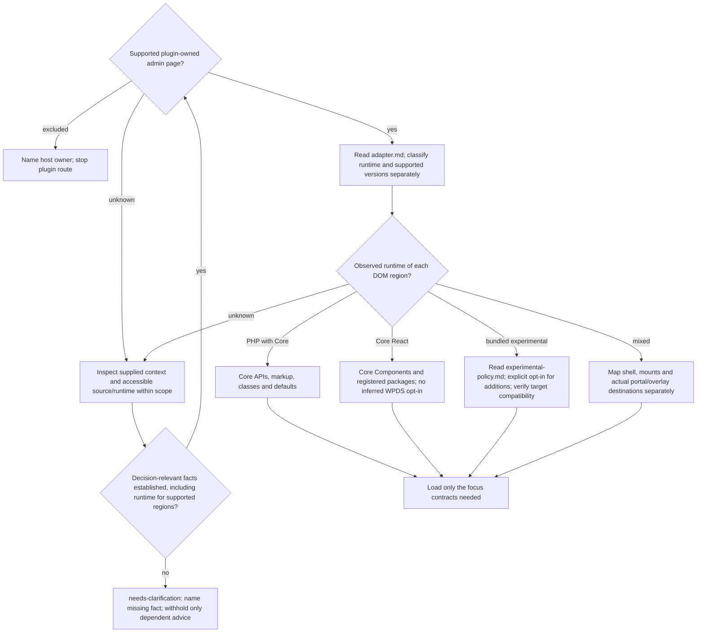

# Task, surface, and runtime routing

Read before any wp-admin recommendation, including hypothetical advice. This
router owns support boundaries; use the mode in Scoville UI. Read
[classification-output.md](classification-output.md) only for an explicitly
requested structured report, never for ordinary advice.

## Select the focus

Take the page/region and concerns from the request. Combine concerns only when
requested or causally necessary. A page audit covers that page's applicable
concerns, not every plugin screen; a targeted audit covers the selected concern
and needed dependencies. Implement applies relevant contracts to the new page
or changed region, not unrelated screens.

| Focus | Inspect | Main reference |
| --- | --- | --- |
| Spacing, vertical flow and composition | Before choosing gaps, margins, padding, stacks, cards, fields or portals: inspect parent and child ownership, hidden content, Core defaults and actual rendered distances where available. | [spacing.md](spacing.md) |
| Core defaults, tokens, and CSS | Runtime owner, reused Core markup and components, token availability and loading when consumed, CSS exceptions before custom styling. | [spacing.md](spacing.md); [version-compatibility.md](version-compatibility.md) for token/provider availability, loading, fallback or version-sensitive advice |
| Responsive layout | Page shells, columns, toolbars, data views, narrow widths, zoom, RTL and content expansion: affected reflow, wrapping, overflow, order and relevant widths. | [responsive.md](responsive.md) |
| User guidance and states | Navigation, hierarchy, actions, forms, Notices, loading, empty, success, error, disabled, permission and recovery states possible in the selected flow. | [ui-guidance.md](ui-guidance.md) |
| Accessibility | Relevant semantics, keyboard and focus behavior, labels, contrast, targets, and reflow. | [ui-guidance.md](ui-guidance.md), [responsive.md](responsive.md) for layout |
| Interface text, locale values, translation loading or i18n-readiness | New or changed visible and accessible strings, dates, numbers, domains, formatting, dependencies, loading hooks, localized layout, expansion and language-scoped RTL. Translation delivery only when requested. | [internationalization.md](internationalization.md) |

When the selected claims trigger [common Validation](../validation.md), apply
[WordPress additions](validation.md) in the same check. Consistency claims also load the
[complete inventory coverage contract](../ui-consistency-audit.md).
References add no scope: a spacing review does not automatically add catalogs,
RTL, navigation redesign or every state.

## Surface support

| Surface | Support and shell owner | Boundaries |
| --- | --- | --- |
| Plugin single-site settings/tool | Supported; Core shell | Preserve working Classic elements and defaults. |
| Plugin workflow/dashboard/data view | Supported; Core shell plus explicit plugin root | One owner per region. |
| Plugin Network Admin page | Supported with explicit Multisite context; Network Admin shell | Establish placement separately from runtime. |
| Block Editor sidebar/SlotFill or editor canvas | Excluded; Block Editor or Editor owner | No frontend-theme spacing or dependent recommendations without host facts. |
| Post metabox, Dashboard widget, existing Core list/screen | Excluded; corresponding Core host | No experimental WPDS injection or global admin overrides. |
| Profile field | Excluded; Core profile screen | No experimental injection, global overrides or CSS before checking Core. |
| UI inside another plugin | Excluded; host plugin | React proves no WPDS ownership; no dependent recommendations without owner facts. |

Excluded surfaces stop the plugin route: no plugin-page shell, generic spacing
matrix, global admin CSS or general-route bypass. Unknown placement leaves shell
ownership unresolved; runtime opt-in never establishes a Core shell.

## Choose the runtime per region

An explicitly unspecified experimental policy stays unknown even for Core
Components; it permits no experimental additions. Known non-experimental PHP/Core
or Core-only hybrid requests use deny.
New experimental APIs require explicit opt-in; unknown behaves as deny. An existing
experimental subtree retains its owner absent a functional reason to change it.
Read [experimental-policy.md](experimental-policy.md) before experimental changes
or advice. Core tokens/public provider are distinct capabilities, not experimental
component opt-in. React alone establishes neither WPDS nor shell ownership.

For token/provider availability, loading, fallback or version-sensitive advice,
read [version-compatibility.md](version-compatibility.md). Native regions consuming
no tokens need no token audit. PHP with Core tokens remains `php-core`.

Continue independent checks when a needed fact remains unknown. Ask only for the
remaining decision-relevant fact after inspecting accessible sources. No complete
classification report is required for ordinary findings. Structured values and
precedence belong to classification-output.md.

## Fact labels

- **Core:** documented API, established admin convention, or explicitly named
  observed implementation with its WordPress version named.
- **WPDS:** documented or observed token or component behavior with its provider
  and version named. This label does not by itself mean experimental.
- **WCAG:** normative accessibility requirement.
- **Skill-Norm:** an openly identified rule that closes an unspecified gap.

Observed Core selectors are not automatically public extension APIs.
