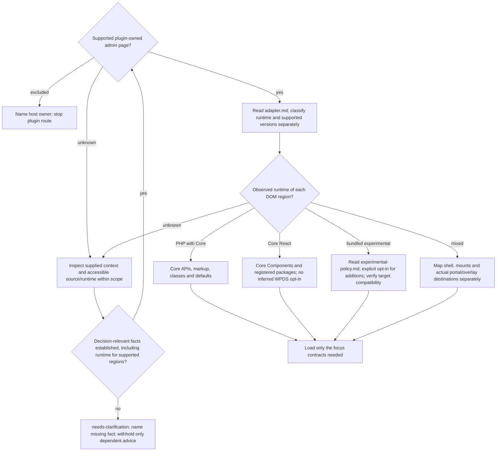

# Task, surface, and runtime routing

Read before any wp-admin recommendation, including hypothetical advice. This
router owns support boundaries; use the mode in Scoville UI. Read
[classification-output.md](classification-output.md) only for an explicitly
requested structured report, never for ordinary advice.

## Select the focus

Take the page/region and concerns from the request. Combine concerns only when
requested or causally necessary. A page audit covers that page's applicable
concerns, not every plugin screen; a targeted audit covers the selected concern
and needed dependencies. Implement applies relevant contracts to the new page
or changed region, not unrelated screens.

| Focus | Inspect | Main reference |
| --- | --- | --- |
| Spacing and vertical flow | Parent and child ownership, gap versus margins, internal padding, hidden content, Core defaults, actual rendered distances where available. | [spacing.md](spacing.md) |
| Core defaults, tokens, and CSS | Runtime owner, reused Core markup and components, token availability and loading when consumed, CSS exceptions. | [spacing.md](spacing.md), [version-compatibility.md](version-compatibility.md) when version-sensitive |
| Responsive layout | Affected reflow, wrapping, overflow, order, zoom, and relevant widths. | [responsive.md](responsive.md) |
| User guidance and states | Task hierarchy, actions, feedback, recovery, and states possible in the selected flow. | [ui-guidance.md](ui-guidance.md) |
| Accessibility | Relevant semantics, keyboard and focus behavior, labels, contrast, targets, and reflow. | [ui-guidance.md](ui-guidance.md), [responsive.md](responsive.md) for layout |
| i18n-readiness | Strings, domains, formatting, dependencies and loading hooks, expansion, and language-scoped RTL. Translation delivery only when requested. | [internationalization.md](internationalization.md) |

For consistency, load validation.md and its complete inventory-coverage contract.
For spacing, inspect the affected subtree's actual owner, then measure computed
styles and geometry for rendered claims; gap alone proves no visible distance.
Compare Core/component defaults before a Skill-Norm. Native spacing is not defective
merely for differing from the fallback scale. Add responsive/state cases only
when they can change the conclusion, such as wrapped controls or hidden children.
Do not automatically add catalogs, RTL, navigation redesign or every state.
Source-only work reports its unverified rendering boundary and needs no browser;
missing runtime evidence never creates a rendered pass. Stop at proportionate
proof of the requested outcome.

## Surface support

| Surface | Support and shell owner | Boundaries |
| --- | --- | --- |
| Plugin single-site settings/tool | Supported; Core shell | Preserve working Classic elements and defaults. |
| Plugin workflow/dashboard/data view | Supported; Core shell plus explicit plugin root | One owner per region. |
| Plugin Network Admin page | Supported with explicit Multisite context; Network Admin shell | Establish placement separately from runtime. |
| Block Editor sidebar/SlotFill or editor canvas | Excluded; Block Editor or Editor owner | No frontend-theme spacing or dependent recommendations without host facts. |
| Post metabox, Dashboard widget, existing Core list/screen | Excluded; corresponding Core host | No experimental WPDS injection or global admin overrides. |
| Profile field | Excluded; Core profile screen | No experimental injection, global overrides or CSS before checking Core. |
| UI inside another plugin | Excluded; host plugin | React proves no WPDS ownership; no dependent recommendations without owner facts. |

Excluded surfaces stop the plugin route: no plugin-page shell, generic spacing
matrix, global admin CSS or general-route bypass. Unknown placement leaves shell
ownership unresolved; runtime opt-in never establishes a Core shell.

## Choose the runtime per region

Core owns .wrap, title, .wp-header-end, page Notices, native .form-table,
controls and p.submit. Preserve Classic pages; token availability requires no
React rewrite, token migration or primitive replacement. Use tokens only for an
actual plugin-owned gap/domain state, never to restyle native controls.
Core Components own their internal spacing; stable Flex owns a new generic group.
A plugin gap stack and .form-table never own the same subtree.

An explicitly unspecified experimental policy stays unknown even for Core
Components; it permits no experimental additions. Known non-experimental PHP/Core
or Core-only hybrid requests use deny.
New experimental APIs require explicit opt-in; unknown behaves as deny. An existing
experimental subtree retains its owner absent a functional reason to change it.
Read [experimental-policy.md](experimental-policy.md) before experimental changes
or advice. Core tokens/public provider are distinct capabilities, not experimental
component opt-in. React alone establishes neither WPDS nor shell ownership.

For token/provider availability, loading, fallback or version-sensitive advice,
read [version-compatibility.md](version-compatibility.md). Native regions consuming
no tokens need no token audit. Distinguish minimum supported from actually tested
WordPress version; stable 7.0/7.1 examples prove neither 6.x nor future/prerelease
support. Registration is not loading; version-sensitive results name supported
and observed versions, token stylesheet owner/names, loading and fallback evidence.
These facts do not turn PHP with Core tokens into bundled-wpds.

Continue independent checks when a needed fact remains unknown. Ask only for the
remaining decision-relevant fact after inspecting accessible sources. No complete
classification report is required for ordinary findings. Structured values and
precedence belong to classification-output.md.

## Fact labels

- **Core:** documented API, established admin convention, or explicitly named
  observed implementation with its WordPress version named.
- **WPDS:** documented or observed token or component behavior with its provider
  and version named. This label does not by itself mean experimental.
- **WCAG:** normative accessibility requirement.
- **Skill-Norm:** an openly identified rule that closes an unspecified gap.

Observed Core selectors are not automatically public extension APIs.
