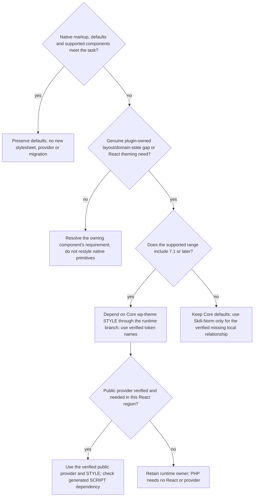

# Versioned Core tokens and public theming

This file holds the Core design tokens and the public React theme provider
by WordPress version, the PHP and React examples that use them, and their
checks. Read it after routing for token or provider availability, loading,
fallback or version-sensitive advice. The WordPress version, the availability
of CSS tokens and the components of a React region are three separate facts;
establish each.

Use an example only for a relationship that Core leaves unspaced, as
[spacing.md](spacing.md) defines it. A resolved pixel value from a check
describes one named state; do not write it back as a source declaration in
place of the token expression. Native relationships are in
[classic-patterns.md](classic-patterns.md), token facts in
[wpds-tokens.md](wpds-tokens.md).

## WordPress version and capabilities

| Target | Core token stylesheet | Public provider | Routing consequence |
| --- | --- | --- | --- |
| 7.0 pinned baseline | No Core `wp-theme` style handle in the verified baseline | Not exported by pinned `@wordpress/theme` 0.7.1 | Preserve Classic pages and Core defaults. Bundled experimental WPDS at this pin: [experimental-policy.md](experimental-policy.md). |
| 7.1 | Core registers `wp-theme` with semantic tokens for plugin UIs | Public `ThemeProvider` from `@wordpress/theme` through the Core script handle | PHP may consume Core tokens without React. React may use the public provider when needed. |

- Take the supported version range from the project. Whenever plugin CSS
  consumes Core tokens, branch at runtime as the
  [PHP example](#php-layout-with-a-core-token-and-older-version-branch) does,
  whatever the range; WordPress skips a stylesheet whose dependency is not
  registered, so the branch keeps the layout where the handle is missing.
- The style and script registries are separate, although both use `wp-theme`.
- A registered handle does not prove enqueue, successful loading, token
  availability or rendering.
- Do not infer future 7.x behavior or package versions from either row. The
  PHP example takes its token branch on releases after 7.1 too; that branch
  stays unverified there, not proven.

## Compatibility rules



- Never bundle a second copy of the Core tokens, replace or deregister the
  Core handle, or depend on an unregistered handle.
- Never unlock private APIs, such as a private theme provider, on any version.
- An approved backport to an older version needs its own code branch that
  checks where the stylesheet comes from and which tokens it has; a present
  handle is not enough.
- Available tokens are no reason to add a provider.

## PHP layout with a Core-token and older-version branch

This example adds a grid only for a new plugin-owned summary region that no
Core markup lays out. The plugin main file defines this hook. Replace the
example page hook with the value the menu registration function returned.

```php
function plugin_slug_enqueue_summary_layout( $hook_suffix ) {
    if ( 'settings_page_plugin-slug' !== $hook_suffix ) {
        return;
    }

    // Core registers the wp-theme stylesheet from WordPress 7.1 on.
    $has_core_tokens = version_compare( get_bloginfo( 'version' ), '7.1', '>=' )
        && wp_style_is( 'wp-theme', 'registered' );
    $dependencies   = $has_core_tokens ? array( 'wp-theme' ) : array();

    wp_enqueue_style(
        'plugin-slug-summary-layout',
        plugins_url( 'assets/summary-layout.css', __FILE__ ),
        $dependencies,
        '1.0.0'
    );

    $gap = $has_core_tokens ? 'var(--wpds-dimension-gap-lg)' : '16px';
    wp_add_inline_style(
        'plugin-slug-summary-layout',
        '.plugin-slug-summary-grid { gap: ' . $gap . '; }'
    );
}
add_action( 'admin_enqueue_scripts', 'plugin_slug_enqueue_summary_layout' );
```

The plugin's `assets/summary-layout.css` contains only the missing layout:

```css
.plugin-slug-summary-grid {
    display: grid;
    grid-template-columns: repeat(auto-fit, minmax(min(100%, 18rem), 1fr));
}
```

On verified 7.1, the dependency causes Core's tokens to load before the plugin
layout. On the verified 7.0 baseline without that style registration, the
explicit `16px` Skill-Norm fallback expresses related summary groups. It does
not pretend to be a WordPress token and does not copy Core token definitions.
The example introduces no new plugin spacing variable or token namespace.

- Do not hand-write a numeric fallback inside the token reference. A fallback
  generated by official build tooling changes neither this rule nor the
  rendered token check.

## React with the public 7.1 provider

The provider is a separate, optional React capability. It is not how PHP
loads tokens. For a plugin-owned React region that actually needs theming, use
the public export from the target's supported package entry:

```jsx
import { ThemeProvider } from '@wordpress/theme';

export function PluginThemeBoundary( { children } ) {
    return <ThemeProvider>{ children }</ThemeProvider>;
}
```

The 7.1 provider renders a wrapper `div` whose Core class uses
`display: contents`. It creates no independent layout box, but it does apply
the resolved corner-radius preset attribute even without color overrides and
does not accept wrapper customization props.

- Add only props verified as public in `@wordpress/theme` 1.0.0, and only for
  an explicit requirement.
- Do not use `isRoot` in a plugin subtree inside the Core document.
- Do not assume that every prop in the moving package docs exists in 7.1.
- Leave the components that render the region as they are.

| Target | Provider entry |
| --- | --- |
| Supported 7.1 package | Public `@wordpress/theme` export shown above. |
| Pinned 7.0 | Separately built no-provider entry; no public export assumed. |

A conditional JSX branch around a missing static export is not a compatible fallback.

1. Build against a package version compatible with the target.
2. With WordPress dependency extraction, verify `build/index.asset.php` includes
   the `wp-theme` script dependency and the entry bundles no second provider runtime.
3. Enqueue `wp-theme` as a **style** dependency too. Register the script with its
   generated dependencies and bind translations as in
   [internationalization.md](internationalization.md#prepare-loading-without-requiring-catalogs).
4. Keep the CSS subpath out of the JS entry.

The provider does not replace the token stylesheet. CSS inheritance follows
the DOM, so a portal takes its tokens from the element it renders into.
Iframes and popup documents need their own stylesheet loading. Do not pass
plugin theming on to the Core document or to other plugins.

## Check outcomes

Implementing and a source review decide the dependency, the branch and the
token names from the source. Loading, token resolution and other
installations are judged only in a rendered check.

Beyond the rules above, these cases fail or stay unverified:

| Case | Required result |
| --- | --- |
| WordPress 7.0 with an unrelated or unapproved `wp-theme` registration, such as one from the Gutenberg plugin | Ignore it for the Core 7.1 path and use the verified older-version fallback. |
| WordPress 7.1 with the Core handle unexpectedly missing | Preserve layout with the fallback, but fail token acceptance and investigate the installation. |
| Other minors (including 7.2), prereleases or unknown version | Unverified. The runtime branch still applies; the numeric fallback does not establish support or pass token acceptance. |
| Registered but not loaded, or required token missing | Fail loading/token acceptance. Investigate the real document and registration, not which runtime renders the region. |

A requested rendered check inspects the token and its consuming property
separately:

```js
const style = getComputedStyle(document.querySelector('.plugin-slug-summary-grid'));
const token = style.getPropertyValue('--wpds-dimension-gap-lg').trim();
if (!token) throw new Error('Required Core gap token is missing');
if (style.gap !== '16px') throw new Error('Unexpected gap for the verified default density');
```

- On a stable 7.1 installation that uses this example, require the Core
  handle and run the token assertion, whichever branch the code took. An
  unexpected numeric fallback does not pass token acceptance.
- On the supported 7.0 fallback, assert the computed `gap` without requiring
  the token.
- The `16px` expectation is the default-density value, the only density the
  7.1 Core stylesheet ships ([wpds-tokens.md](wpds-tokens.md)).

Primary sources and immutable release refs are in [sources.md](sources.md).
